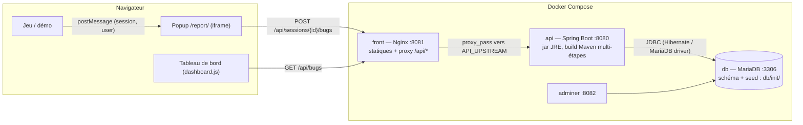
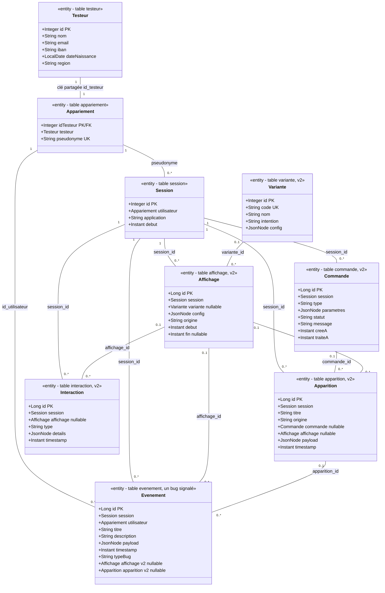
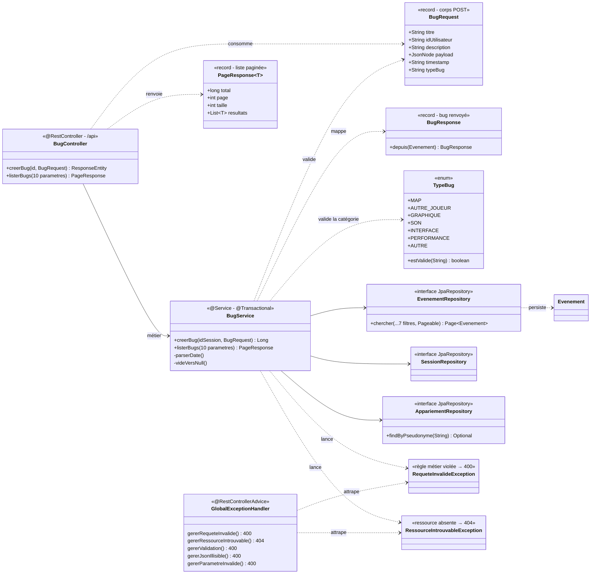
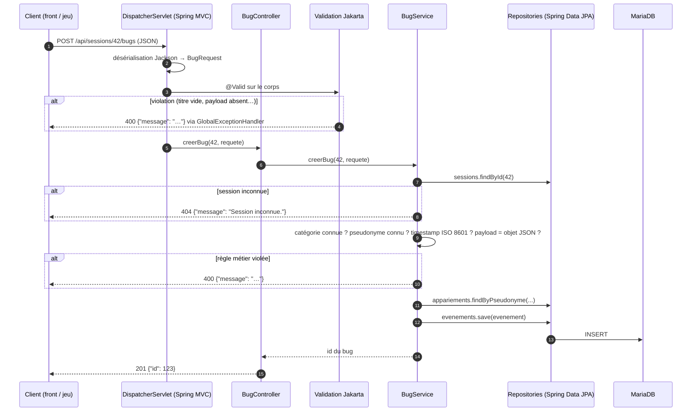

# KAPTURE FAIRPLAY Analytics — Doc technique

Vue technique du POC : architecture, modèle de données, et fonctionnement interne de l'API Spring Boot.
Le contrat d'API (champs, codes, messages) reste dans [API.md](API.md), les règles fonctionnelles dans [Specs.md](Specs.md).

**Stack** : Java 21 · Spring Boot 4.1 (Web MVC, Data JPA, Validation) · MariaDB · Docker Compose · front HTML/JS servi par Nginx.

---

## 1. Architecture générale

Quatre conteneurs, un seul point d'entrée HTTP côté navigateur (Nginx, port 8081) qui sert les pages statiques et relaie `/api/*` vers Spring Boot.

Points clés :

- **`API_UPSTREAM`** (`.env`) bascule Nginx vers le conteneur `api:8080` (prod) ou `host.docker.internal:8080` (API lancée en local avec `./mvnw spring-boot:run`). La résolution DNS est faite à la requête : le front démarre même si l'API est arrêtée (502).
- **Cloisonnement des données** : l'API ne renvoie que le pseudonyme (`appariement.pseudonyme`). Les colonnes nominatives de `testeur` (nom, email, IBAN…) ne sortent jamais par HTTP.
- **Base cloisonnée** : chaque session appartient à un seul testeur ; les bugs sont rattachés à une session et à un pseudonyme par clés étrangères.

---

## 2. Modèle de données et diagramme de classes

### 2.1 Tables (couche persistée)

Neuf tables, dans deux groupes :

- **v1 (4 tables, `db/init/01-schema.sql`)** : `testeur` (nominatif) → `appariement` (pseudonyme, 1-1 à clé partagée `id_testeur`) → `session` / `evenement`.
- **v2 (5 tables + 2 colonnes, `db/init/03-v2.sql`)** :
  - `variante`, `affichage`, `commande`, `apparition`, `interaction` ;
  - `evenement` reçoit `affichage_id` et `apparition_id`, tous deux optionnels. Détail en §4.1.

Les noms de champs suivent les entités Java. Les colonnes correspondantes sont en `snake_case` (`creeA` → `cree_a`).

Valeurs possibles des colonnes texte v2 (VARCHAR en base, énumérations Java dans `dto/` côté API) :

| Colonne | Valeurs |
| --- | --- |
| `variante.intention` | `INCITER`, `NEUTRE`, `DISSUADER` |
| `affichage.origine` | `DEFAUT`, `OPERATEUR` |
| `commande.type` | `DECLENCHER_BUG` |
| `commande.statut` | `ENVOYEE` → `EXECUTEE` ou `ECHEC` |
| `apparition.origine` | `JEU` (spontané), `COMMANDE` (déclenché par l'application) |
| `interaction.type` | `SURVOL`, `OUVERTURE`, `ANNULATION` |

Correspondances JPA notables :

| Association | Mapping | Remarque |
| --- | --- | --- |
| `Appariement.testeur` | `@OneToOne` + `@JoinColumn(insertable = false, updatable = false)` | clé partagée : `id_testeur` est à la fois PK et FK |
| `Evenement.session` | `@ManyToOne(LAZY)` sur `session_id` | `nullable = false` |
| `Evenement.utilisateur` | `@ManyToOne(LAZY)` sur `id_utilisateur` → `pseudonyme` | jointure par le pseudonyme, pas par l'id |
| `Evenement.payload` | `@JdbcTypeCode(SqlTypes.JSON)` | objet JSON stocké tel quel, sans schéma imposé |
| Associations v2 | `@ManyToOne(LAZY)` | `session` obligatoire, les autres optionnelles (null autorisé) |
| Colonnes JSON v2 (`config`, `parametres`, `payload`, `details`) | `JsonNode` + `@JdbcTypeCode(SqlTypes.JSON)` | même principe que `Evenement.payload` |

### 2.2 Classes de l'API (couche applicative)

Architecture en couches stricte : **Controller → Service → Repository → (JPA/Hibernate) → MariaDB**. Le contrôleur ne fait que le mapping HTTP, le service porte les règles métier, les repositories n'exposent que l'accès aux données.

---

## 3. Comment marche l'API Spring Boot

### 3.1 Démarrage

`ApiApplication` est annotée `@SpringBootApplication` (= `@Configuration` + `@EnableAutoConfiguration` + `@ComponentScan` sur `fr.kapture.api`). Au lancement, Spring Boot :

1. scanne le package et instancie les beans (`BugController`, `BugService`, les proxies des `@Repository`) ;
2. auto-configure le serveur Tomcat embarqué sur le port **8080** ;
3. lit `application.properties`, dont `spring.config.import=optional:file:../.env` → identifiants MariaDB, et `spring.jpa.hibernate.ddl-auto=update` ;
4. crée la pool de connexions JDBC vers `jdbc:mariadb://localhost:3306/kapture`.

L'injection se fait par **constructeur** : chaque classe déclare ses dépendances `final`, Spring fournit les instances (pas d'`@Autowired` sur champ).

### 3.2 Le trajet d'une requête

Même mécanique pour `GET /api/bugs` : le contrôleur reçoit 10 `@RequestParam` optionnels, le service valide tri/ordre/pagination puis appelle `EvenementRepository.chercher(...)`.

### 3.3 Le rôle des annotations

| Annotation | Où | Rôle |
| --- | --- | --- |
| `@RestController` + `@RequestMapping("/api")` | `BugController` | chaque méthode renvoie directement le corps JSON (pas de vue) ; le préfixe `/api` est commun aux deux routes |
| `@PostMapping` / `@GetMapping` | méthodes du contrôleur | route + verbe HTTP |
| `@PathVariable("id")` | `creerBug` | `{id}` de l'URL → `idSession` |
| `@RequestBody` | `creerBug` | corps JSON → `BugRequest` (désérialisé par Jackson) |
| `@RequestParam(required = false)` | `listerBugs` | paramètres de query, tous optionnels |
| `@Valid` + `jakarta.validation.*` | `BugRequest` | validation déclarative (`@NotBlank`, `@Size`, `@NotNull`) déclenchée avant le service |
| `@Service` + `@Transactional` | `BugService` | bean métier + transaction englobant les accès JPA |
| `JpaRepository` + `@Query` (JPQL) | repositories | CRUD gratuit + requête filtrée ; `Pageable` porte tri et pagination |
| `@RestControllerAdvice` | `GlobalExceptionHandler` | intercepte les exceptions → format d'erreur unique `{"message": "…"}` |
| `@JsonProperty` / `@JsonFormat` | DTOs | clés JSON en `snake_case` (contrat v1) et timestamp `ISO 8601 UTC` |

### 3.4 Détails de fonctionnement

- **DTO vs entité** : l'API ne manipule que des records (`BugRequest`, `BugResponse`, `PageResponse<T>`) en entrée/sortie. Les entités JPA (`Evenement`, `Session`, `Appariement`, `Testeur`) restent en couche persistante ; `BugResponse.depuis(Evenement)` fait la conversion par navigation dans les associations. Le record garantit des objets immuables et un contrat JSON stable.
- **Validation en deux temps** : la forme (champs obligatoires, longueurs) est déclarée sur `BugRequest` par Jakarta et levée par `@Valid` ; le sens (catégorie dans l'énumération `TypeBug`, pseudonyme existant, `timestamp` parsable en `Instant`, `payload` objet JSON) est vérifié dans `BugService`.
- **`payload` en `JsonNode`** : le JSON est stocké dans une colonne MariaDB `JSON` sans validation de schéma (`@JdbcTypeCode(SqlTypes.JSON)`) — le popup y ajoute librement une clé `comportement`.
- **Liste filtrée en une seule requête** : `EvenementRepository.chercher` fait un `join fetch` sur `session` et `utilisateur` pour éviter le N+1, chaque filtre étant ignoré quand son paramètre est `null` (`(:typeBug is null or e.typeBug = :typeBug)`). La `countQuery` sépare le `total` (après filtres, avant pagination) des `resultats`.
- **Tri sans injection SQL** : les valeurs de `tri` sont mappées vers des propriétés JPA par une whitelist (`PROPRIETES_TRI` : `id_utilisateur` → `utilisateur.pseudonyme`), puis un tri par `id` est ajouté comme dédoublonneur. `ordre` n'accepte que `asc`/`desc`.
- **Gestion des erreurs** : le service lance `RequeteInvalideException` (400) ou `RessourceIntrouvableException` (404) ; `GlobalExceptionHandler` les convertit en `{"message": "…"}`, et couvre aussi les violations Jakarta, les corps JSON illisibles et les paramètres mal typés (`page=abc`).
- **Cloisonnement** : `Testeur` et `TesteurRepository` existent pour compléter le modèle mais ne sont jamais exposés — seuls le pseudonyme et les données de session sortent par l'API.

---

## 4. v2 — overlay, variantes, suivi (backend)

Contrat : [docs/V2.md](docs/V2.md). Résumé de ce qui a été ajouté côté API.

### 4.1 Tables et entités

| Table | Entité | Rôle | Associations (`@ManyToOne` LAZY) |
| --- | --- | --- | --- |
| `variante` | `Variante` | catalogue des variantes du bouton (`config` JSON) | — |
| `affichage` | `Affichage` | variante réellement rendue par l'overlay, `debut` → `fin` | `session`, `variante` (null = config personnalisée) |
| `commande` | `Commande` | ordre envoyé au jeu (`DECLENCHER_BUG`), `ENVOYEE` → `EXECUTEE`/`ECHEC` | `session` |
| `apparition` | `Apparition` | bug apparu dans le jeu (`JEU` ou `COMMANDE`) | `session`, `commande`, `affichage` |
| `interaction` | `Interaction` | `SURVOL` / `OUVERTURE` / `ANNULATION` du bouton | `session`, `affichage` |
| `evenement` (+2 colonnes) | `Evenement` | `affichage_id`, `apparition_id` optionnels | `affichage`, `apparition` |

Colonnes JSON en `JsonNode` + `@JdbcTypeCode(SqlTypes.JSON)`, comme `Evenement.payload`. Schéma : `db/init/03-v2.sql` (volume neuf) ; sur une base existante, `ddl-auto=update` crée tables et colonnes au démarrage. Le catalogue (§5.2 du contrat) est inséré par `config/InitialisationCatalogue` (`ApplicationRunner`) si `variante` est vide.

Diagramme de classes complet (v1 + v2, avec attributs et cardinalités) : voir §2.1.

### 4.2 Classes

| Couche | Classes |
| --- | --- |
| Contrôleurs | `SessionController` (variantes, sessions, PUT variante), `CommandeController`, `CollecteController` (affichages, apparitions, interactions), `SuiviController` (chronologie, statistiques), `FluxController` (les deux SSE) |
| Services | `SessionService` (état en direct, variante courante, ouverture du flux overlay), `CommandeService`, `CollecteService`, `SuiviService` (agrégats en Java), `FluxService` (registre SSE + publication), `ReferencesSession` (contrôles partagés : session 404, `affichage_id`/`apparition_id`/`commande_id` de la même session 400) |
| DTO | `ConfigBouton` (+ `Badge`, validés par Jakarta avec les messages du contrat), requêtes/réponses en records snake_case, `EntreeChronologie`, `StatVariante`, `SessionEtat`, `VarianteCourante`, enums fermés (`Intention`, `OrigineAffichage`, `OrigineApparition`, `TypeInteraction`, `TypeCommande`, `StatutCommande`, `TypeEntree`) |
| Exceptions | `ConflitException` → `409` dans `GlobalExceptionHandler` (dont le corps d'erreur est désormais forcé en `application/json`, pour qu'un 404 sur une route SSE reste lisible) |

### 4.3 SSE (`FluxService`)

- **Registre thread-safe** : `ConcurrentHashMap<sessionId, CopyOnWriteArrayList>` pour les overlays, `CopyOnWriteArrayList` pour les consoles ; `SseEmitter(0L)` (pas de timeout) ; envoi synchronisé par émetteur.
- **Nettoyage** : retrait idempotent sur `onCompletion` / `onTimeout` / `onError` et sur `IOException` à l'envoi. Le serveur ne voit un client parti qu'en écrivant : le **`:ping` toutes les 15 s** (`@Scheduled`, activé par `config/ConfigurationPlanification`) sert aussi de détection. En pratique, avec Tomcat, une déconnexion est vue en 15 à 30 s (la première écriture après fermeture peut encore réussir).
- **Déconnexion du dernier overlay d'une session** : l'affichage ouvert est fermé (`fin` = maintenant) puis une entrée `CONNEXION {connecte:false, overlays:0}` part à la console. Ce traitement tourne sur un thread dédié (`flux-retraits`), jamais dans la transaction d'une requête.
- **Publication après commit** : `publierChronologie` / `publierAuxOverlays` s'enregistrent comme `TransactionSynchronization.afterCommit` quand une transaction est active, sinon envoient tout de suite. La console ne reçoit donc jamais une ligne pas encore commitée.
- **Variante courante d'une session** : assignation en mémoire (`PUT …/variante`, perdue au redémarrage), sinon config du dernier affichage de la session, sinon `NEUTRE` origine `DEFAUT`.
- Les en-têtes `X-Accel-Buffering: no` et `Cache-Control: no-cache` sont posés sur les deux flux (Nginx doit aussi avoir `proxy_buffering off`).

---

## 5. Annexe — sources

| Sujet | Fichiers |
| --- | --- |
| Contrat HTTP | [API.md](API.md), `api/src/main/java/fr/kapture/api/controller/BugController.java` |
| Règles métier | `api/src/main/java/fr/kapture/api/service/BugService.java` |
| Entités / tables | `api/src/main/java/fr/kapture/api/entity/`, `db/init/01-schema.sql`, `db/init/03-v2.sql` |
| v2 (contrat, SSE) | [docs/V2.md](docs/V2.md), `api/src/main/java/fr/kapture/api/service/FluxService.java` |
| Erreurs | `api/src/main/java/fr/kapture/api/exception/` |
| Config / Docker | `api/src/main/resources/application.properties`, `docker-compose.yml`, `api/Dockerfile`, `front/nginx.conf` |
